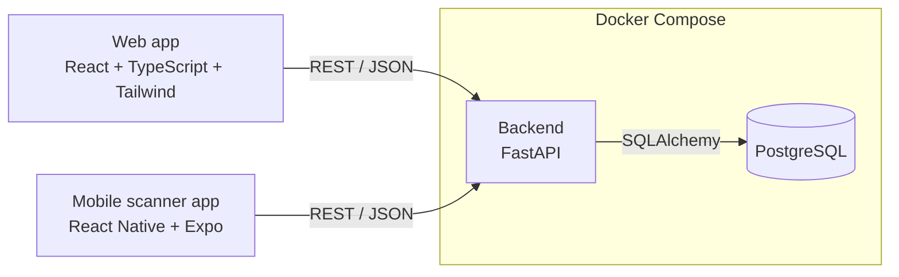
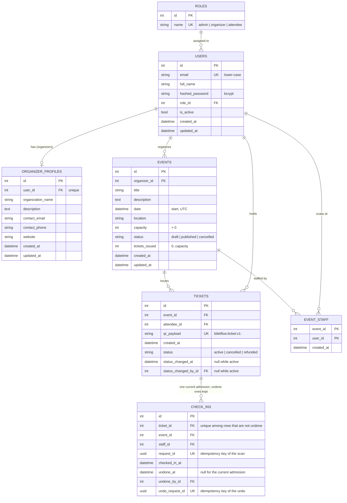

# Palantir – System Architecture

## P2 demo checkout and activation

P2 adds simulated paid sales (SRS 3.2, 4.5, 4.6). Money is integer tiyn, payment screens and
successful payment responses are labelled as a simulation. No external provider is contacted.

Data path: `EventActions` selects a paid type → `CheckoutPage` posts contact details and a UUID
to `routers/orders.py` → the service locks the event, expires old reservations, checks activation,
suspension, ticket ownership and pending orders → conditional event/type UPDATEs reserve one
seat → `orders` stores a price/fee snapshot and a 15-minute deadline. `OrdersPage` displays the
server total, then posts a simulated success or failure. Success inserts the normal `Ticket`,
marks the order paid and records `order.paid` in one transaction. QR, PDF and check-in reuse the
existing ticket path. Failure records `order.failed` and releases both counters.

New modules: `models/order.py` and migration `0006` (`down_revision="0005"`), `schemas/order.py`,
`routers/orders.py`, `routers/paid_sales.py`, `paid_sales.py`, `order_inventory.py`, `demo_fees.py`,
and `scripts/expire_orders.py`. The web adds `orders/model.ts`, `CheckoutPage`, `OrdersPage` and
`ActivationPage`. Shared router/navigation and event/type pages receive small links and fields.

The organizer checklist has five steps: a paid type, simulated profile identity and payout
suffix, per-event terms, and the per-event activation fee. `paid_sales_activations` stores fee
amount/time, activation time and the independent paid-sales suspension. Full payout references
are never accepted: `reference_last4` is exactly four ASCII letters/digits. Organizer profile
steps are owner-only, event steps and summaries are owner/admin, suspension is admin-only, and
orders are buyer-only (404 for every other account, including admins). `EventRead` adds only
`paid_sales_available` for the purchase button. All business denials use `api_error`.

The shared lock order is event → order/ticket/type. Cleanup, free claim, checkout, confirmation,
capacity/type edits and admin suspension serialize through the same event row. Existing
conditional UPDATEs and event suspension guards remain in place. A pending order occupies
inventory but has no ticket. Only `pending` can release its seat; replayed cleanup/cancellation
does nothing. Confirmation rechecks the deadline after acquiring the event lock, so a request
that waited beyond its deadline cannot issue. Payment converts the reserve without a second
increment. Event/type counters equal active tickets plus pending reservations.

Expiry runs lazily on inventory and order reads/writes and through `python -m scripts.expire_orders`.
It needs no worker. Multiple-event cleanup locks IDs in ascending order. A read may therefore
persist expiry. The table can retain an expired-time pending row until the next access, but
inventory operations clean it before using availability. A reservation keeps the original
price and can be paid until its deadline after the type's sales window closes; event and
paid-sales suspension still refuse payment. Every operation is a database transaction.

The one-ticket constraint remains unconditional. P2 refuses an existing active ticket with
`ACTIVE_TICKET_EXISTS`, a closed ticket with `CLOSED_TICKET_EXISTS`, and a live reserve with
`PENDING_ORDER_EXISTS`. Free claims retain HTTP 200 replay for existing tickets of every state.
They gain only expiry and pending-order coordination before new issuance. One order buys one
ticket and validates `order_limit >= 1`. Zero-price orders for free claims remain a known
SRS 4.4 gap. Order contact snapshots do not change account ownership or the existing PDF/check-in identity.

Creation is idempotent on `(buyer_id, request_id)` with a payload-match check. A partial unique
index also permits at most one pending order per buyer/event. Confirmation is idempotent on
the order ID: the first terminal outcome wins. Paid orders have a unique ticket FK and a CHECK
constraint requires exactly paid orders to have a ticket. APIs never create tickets for pending,
failed, cancelled or expired orders. Financial refunds are outside P2; existing admission-only
ticket cancellation/refund routes do not rewrite the order or pretend that money was returned.

Fees are coded demo defaults, not new platform settings: activation 500000 tiyn, processing
300 bps deducted from organizer proceeds. Round half up with `(amount * bps + 5000) // 10000`.
The buyer's total equals the ticket price. Orders retain the applied rate and rounded fee.
The summary reports gross paid totals, fees, zero refunds and gross minus fees as estimated payout.

### Campaign attribution (P3) and delivery or refund extensions

A campaign belongs to one event. The server issues a shareable opaque link and a separate human-readable code.
The QR opens the event. Public preview resolves the token and then calculates a quote for the selected ticket type.
Checkout locks the event, checks idempotency, validates the code and remaining uses, and reserves the seat and
campaign use in the same transaction. The order snapshots the code, discount and amount payable. An accepted
reservation retains that price until it expires. Admission rejects campaign links before ticket lookup.

Attribution survives failed and expired attempts. A campaign's order count includes all attempts that created
orders. Paid orders supply redemptions, ticket count, gross value, discounts, net sales and organizer proceeds
after the processing fee. Reports read order rows so a retried confirmation has no second financial effect.

P5 can extend the order lifecycle for financial refunds and
connect existing admission-state transitions under the same event lock, recording refund
amounts and adjusting the organizer summary. B4 may send
a delivery message after a newly paid order commits, with its own deduplication keyed by order ID.

Verification covers unit denials/checklists/rounding/ownership, real PostgreSQL races and
counter-to-row reconciliation, populated migration and downgrade guards, and browser fixtures
for both payment outcomes and activation. SQL must confirm PostgreSQL 16, ICU `und`, UTF8.
This automated evidence is separate from physical phone/printed-ticket acceptance.

Client–server architecture. Two clients talk to one REST API; the API owns the database.



| Layer | Technology |
|---|---|
| Web frontend | React, TypeScript, Tailwind CSS |
| Mobile (event-staff ticket scanning) | React Native with Expo |
| Backend | FastAPI (Python), REST + JSON, interactive docs at `/docs` |
| Database | PostgreSQL, accessed through SQLAlchemy 2.0, schema managed with Alembic migrations |
| Auth | JWT access + refresh tokens, bcrypt password hashes |
| Tests | pytest (backend), React Testing Library (frontend) |
| Deployment | Docker / Docker Compose (`docker-compose.yml`) |

## Backend structure (`backend/app/`)

```
main.py              FastAPI app, CORS, router registration
core/config.py       settings from environment variables
db/                  engine + session (session.py), declarative base (base.py), role seeding (seed.py)
models/              SQLAlchemy models: role, user, organizer_profile, event, ticket, event_staff, check_in
schemas/             Pydantic request/response models (validation lives here)
auth/                security.py (bcrypt + JWT), service.py (logic), router.py (/auth/*)
dependencies/        auth.py (current user), roles.py (RBAC), events.py (event access), db.py (session)
errors.py            api_error(): {"detail": {"code", "message"}} for clients that branch on codes
routers/             organizer_profiles.py, events.py, tickets.py, staff.py, check_ins.py, health.py
```

Request flow: **router → dependencies (token → user → role check) → model/DB**. Routers contain no
password or token logic; that lives in `auth/`.

## Data model



`tickets` is also unique on (`event_id`, `attendee_id`): one free ticket per person per event.

## Authentication and roles

* `POST /auth/register` creates an `attendee` or `organizer`. Admins cannot self-register; they are
  created with `python -m scripts.create_admin`.
* `POST /auth/login` (JSON) and `POST /auth/token` (OAuth2 form, used by the `/docs` "Authorize" button)
  return `{access_token, refresh_token, token_type}`. Access tokens live 30 min, refresh tokens 7 days.
* `POST /auth/refresh` exchanges a refresh token for a new pair. Tokens carry a `type` claim, so a refresh
  token cannot be used as an access token (and vice versa).
* `POST /auth/logout` revokes the presented refresh token (`revoked_tokens`); the access token lapses within 30 min.
* Every token carries `ver` = `users.token_version`. `POST /auth/reset-password` increments it, which ends every
  session and makes the reset link single-use. Verification and reset links are JWTs with their own `type`.
* Every protected endpoint depends on `get_current_user` (401 if the token is missing/invalid/expired,
  403 if the account is disabled). `require_roles(...)` in `dependencies/roles.py` adds the role check (403).

| Endpoint | Who |
|---|---|
| `GET /health`, `POST /auth/register`, `POST /auth/login`, `POST /auth/token`, `POST /auth/refresh` | anyone |
| `POST /auth/logout`, `POST /auth/verify-email`, `POST /auth/forgot-password`, `POST /auth/reset-password` | anyone |
| `GET /events`, `GET /events/{id}` (published or cancelled, not suspended) | anyone |
| `GET /events/{id}` (draft or suspended) | the event's organizer, or an admin |
| `GET /auth/me`, `POST /auth/resend-verification`, `GET /organizer-profiles/{id}` | any logged-in user |
| `POST /events/{id}/tickets`, `GET /tickets/me`, `GET /tickets/{id}`, `GET /tickets/{id}/pdf` (own) | any logged-in user |
| `GET /staff/events` | any logged-in user (lists what they may scan; may be `[]`) |
| `POST /organizer-profiles`, `GET /organizer-profiles/me`, `PUT\|PATCH /organizer-profiles/me` | organizer |
| `POST /events`, `GET /events/mine` | organizer |
| `PUT\|PATCH /events/{id}`, `POST /events/{id}/publish`, `POST /events/{id}/unpublish`, `POST /events/{id}/cancel` | the event's organizer, or an admin |
| `GET\|POST /events/{id}/staff`, `DELETE /events/{id}/staff/{user_id}` | the event's organizer, or an admin |
| `POST /events/{id}/check-in` | the event's assigned staff, its organizer, or an admin |
| `POST /events/{id}/check-ins/{check_in_id}/undo` | the event's organizer, or an admin |
| `POST /tickets/{id}/cancel` | the ticket's attendee, the event's organizer, or an admin |
| `POST /tickets/{id}/refund` | the event's organizer, or an admin |
| `GET /events/{id}/attendance`, `GET /events/{id}/attendees?q=` | the event's assigned staff, its organizer, or an admin |
| `GET /events/{id}/action-log` | the event's organizer, or an admin |
| `GET /admin/users`, `POST /admin/users/{id}/suspend\|reactivate` | admin |
| `GET /admin/events`, `POST /admin/events/{id}/suspend\|reactivate`, `GET /admin/action-log` | admin |
| `POST /support/cases`, `GET /support/cases/mine` | any logged-in user (an `organizer` case needs the organizer role) |
| `GET /support/cases/{id}`, `GET\|POST /support/cases/{id}/messages` | the case's requester or one of its handlers; everyone else gets `404` |
| `PATCH /support/cases/{id}` | a handler; the requester may only set `resolved` |
| `GET /events/{id}/support-cases` | the event's organizer, or an admin |
| `GET /admin/support-cases` | admin |

## Notifications

`app/notifications.py` writes a `notifications` row in the same transaction as the change it reports and queues
the email on the SQLAlchemy session. An `after_commit` listener hands the queue to one worker thread, which keeps emails in commit order; an
`after_rollback` listener discards it. The ticket PDF is rendered in the worker from its own session, so the claim
does not hold the event row lock while the PDF is drawn. Only a claim that creates a ticket calls `ticket_issued`,
so a repeated claim never emails twice. In the same way, `order_paid` and `payment_failed` are called only on
the order's transition out of `pending` under the event lock, so each order sends one email. Queued emails are lost if the process stops before sending; the
notification rows remain.

## Design decisions

* **One role per user** (`users.role_id`). Simple to enforce and test; can become many-to-many later.
* **Mostly stateless JWT.** Logout revokes one refresh token and a password reset revokes all tokens of the user;
  an access token is otherwise trusted until it expires.
* **bcrypt used directly** (not via passlib) – fewer moving parts. Passwords are limited to 72 bytes (bcrypt's limit).
* **Sync SQLAlchemy.** FastAPI runs the sync endpoints in a thread pool; Alembic stays straightforward.
* **Timestamps are UTC.** Datetimes without a timezone are interpreted as UTC; responses are always UTC.
* **Tests use in-memory SQLite**, the app targets PostgreSQL. Models avoid PostgreSQL-only types so both work;
  `tests/test_migrations.py` checks that the Alembic migration applies and rolls back cleanly.

## Tickets and check-in

* Events start as `draft`, become `published` (ticketing and check-in open) and can be `cancelled` (final).
  Publishing is a conditional update, so it can never overwrite a concurrent cancel. A published event that
  nobody holds a seat at can go back to `draft` (see "Editing and unpublishing").
* Claiming a ticket takes an event seat with `UPDATE events SET tickets_issued = tickets_issued + 1
  WHERE ... AND tickets_issued < capacity`; the check constraint backs it up. P1 reserves the type's
  seat in the same transaction.
* Check-in follows `mobile/API.md`. The `check_ins` row is the receipt: resending the same `request_id`
  (same staff, event and QR) returns it, any other reuse is `409 REQUEST_ID_CONFLICT`. A partial unique index on
  `ticket_id` over the rows that are not undone makes a second current admission impossible even when two phones
  scan at once. Access is checked on every request, retries included, so revoked staff get `403`.
* A ticket is `active`, `cancelled` or `refunded` (migration `0003`). The last two are final and never admit:
  check-in answers `409 TICKET_CANCELLED` or `409 TICKET_REFUNDED`. They describe one ticket; `EVENT_CANCELLED`
  describes the whole event and is reported first. Closing a ticket gives its seat back
  (`tickets_issued - 1`), so `tickets_issued` counts active tickets. The ticket keeps its id and `qr_payload`, and
  the attendee's claim keeps returning that closed ticket. A ticket with a current admission cannot be closed
  (`409 TICKET_CHECKED_IN`) until the check-in is undone, so `checked_in` never exceeds `tickets_issued`.
  Tickets are free: `refunded` records the admission state only and no payment is processed.
* `GET /tickets/{id}/pdf` returns the printable ticket: one A4 page drawn with `fpdf2`, the QR built by `qrcode`
  from exactly `ticket.qr_payload` with error correction M and a four-module quiet zone, as on the website. The code
  is black vector rectangles that overlap slightly, because some renderers otherwise leave a white hairline between
  rows and the code stops scanning. Text uses the bundled DejaVu Sans (`app/assets/fonts`, licence beside it), which
  has the Russian and Kazakh letters. The event time is printed in UTC+5 with the offset shown. A closed ticket or a
  ticket of a cancelled event is not printed (`409`). The response is `private, no-store`.
* Undo (`POST /events/{id}/check-ins/{check_in_id}/undo`, organizer or admin) keeps the `check_ins` row and sets
  `undone_at`, `undone_by_id` and `undo_request_id`. The undo has its own `request_id`, so a retry returns the same
  `UNDONE` receipt. The undone check-in's own `request_id` then answers `409 CHECK_IN_UNDONE`: it cannot admit
  again and is never replayed as a success. A new scan with a new `request_id` admits the ticket again as a new
  row. Check-in, undo, cancel and refund lock the event row first and then the ticket row, so they serialise per
  ticket without deadlocks.
* Check-in holds the event row `FOR SHARE` until it commits, so a cancel or publish waits for scans in flight and a scan
  never mixes an old event status with newer staff access. Parallel scans do not block each other.
* New endpoints report errors as `{"detail": {"code": "...", "message": "..."}}`. Codes: `EVENT_NOT_FOUND`,
  `EVENT_NOT_PUBLISHED`, `EVENT_CANCELLED`, `SOLD_OUT`, `CAPACITY_BELOW_ISSUED`, `TICKET_NOT_FOUND`,
  `USER_NOT_FOUND`, `STAFF_CHANGED`, `FORBIDDEN`, `INVALID_TICKET`, `ALREADY_CHECKED_IN`, `REQUEST_ID_CONFLICT`,
  `QUERY_TOO_SHORT`, `TICKET_CANCELLED`, `TICKET_REFUNDED`, `TICKET_CHECKED_IN`, `CHECK_IN_UNDONE`,
  `CHECK_IN_NOT_FOUND`, `CHECK_IN_ALREADY_UNDONE`, `UNDO_NOT_ALLOWED`, `EVENT_SUSPENDED`, `CANNOT_SUSPEND_SELF`,
  `CASE_NOT_FOUND`, `CONTEXT_REQUIRED`, `CONTEXT_MISMATCH`, `CATEGORY_NOT_ALLOWED`, `INVALID_ASSIGNEE`,
  `EVENT_STARTED`, `DATE_IN_PAST`, `EVENT_HAS_TICKETS`.
* `GET /events/{id}/attendance` returns `capacity` and `tickets_issued` from the event row and `checked_in` as a
  `COUNT` of its `check_ins` that are not undone, all read in one statement. `GET /events/{id}/attendees?q=` searches the event's ticket
  holders by name or e-mail (case-insensitive substring, `q` at least 3 characters after trimming, `%`/`_` literal,
  at most 20 results ordered by name). Each result carries the ticket `status`, the
  current `check_in_id` (or `null`) and the exact `qr_payload`, so manual admission goes through the same check-in
  endpoint; there is no second write path. E-mails are masked to at most two leading characters,
  always hiding at least one, plus a fixed `***` and the domain (`ab@x.kz` → `a***@x.kz`). Access is checked before
  `q` is validated.
* Values PostgreSQL refuses to store (NUL characters, ids beyond its integer range) return
  `422 INVALID_INPUT` on every endpoint instead of a 500.

### P1 ticket type inventory and action log

`ticket_types` belongs to an event. It holds the current name, description, integer price
in tiyn, allocation, active ticket count, sales window, order limit and visibility. Every
ticket refers to one type and retains its existing event and attendee identity. The
`(event_id, attendee_id)` uniqueness rule still applies across all types.

The original conditional event update takes the event row lock and reserves an event seat.
A second conditional update reserves the chosen free type's seat in the same transaction.
A rollback returns both reservations. Cancellation and refund release both counters.
Management requests also lock the event row before reading or changing allocations, so
two concurrent requests cannot allocate more seats than the event has.

`action_logs` stores the event, actor, UTC time, action, entity and short description.
The caller adds the record in the transaction that creates or changes a type. The owner
and administrators can read the event's history. The API exposes no write operation on
the history itself.

### Editing and unpublishing (BE-1)

Every edit (`PATCH`/`PUT /events/{id}`) reads the event under its row lock, so it sees a cancel that committed
first. The rules hold for organizers and admins alike; access is checked before them, so someone who may not
manage the event gets `403` and learns nothing about its state.

| Event state | What can change |
|---|---|
| `cancelled` | Nothing: `409 EVENT_CANCELLED`. Its ticket types can't be created or edited either. |
| started (`date` is now or earlier) | Title, description and location. A different `date` or `capacity` is `409 EVENT_STARTED`. |
| not started | Everything, but a new `date` must be in the future (`422 DATE_IN_PAST`). |

Sending a field's current value again is not a change, so a form that resubmits every field works on a started
event. `capacity` still can't drop below `tickets_issued` (`409 CAPACITY_BELOW_ISSUED`). Event creation does not
check the date yet.

`POST /events/{id}/unpublish` takes a `published` event back to `draft`; it is then hidden from the public, the
staff app and ticket claims, and can be published again. It is allowed only while `tickets_issued` is `0`.
That counter includes pending checkout holds, which are expired first, so lapsed holds don't block it.
Otherwise the answer is `409 EVENT_HAS_TICKETS`: an event people hold tickets for should be cancelled, which
notifies them, not hidden. Cancelled and refunded tickets don't count. A draft is a no-op; a cancelled event is
`409 EVENT_CANCELLED`. The change is recorded as `event.unpublished`. Suspension, paid-sales activation, ticket
types and staff are left as they are.

Unpublish takes the same exclusive row lock as ticket claims and checkout. A claim that committed first leaves
a seat, so unpublish is refused; a claim that comes later finds a draft in its conditional `UPDATE` and is refused
(`EVENT_NOT_PUBLISHED`) without taking a seat. A draft therefore never holds a seat.

### Admin suspension and the full event timeline

Migration `0005` adds `events.suspended_at` and makes `action_logs.event_id` nullable.

**Suspending an event** (`POST /admin/events/{id}/suspend`, admin only, with a `reason`) hides it from everyone
except its organizer and admins, exactly like a draft: it leaves the public list, and its details, ticket types and
ticket claims answer `404 EVENT_NOT_FOUND`. The organizer and admins see it with `suspended: true` and cannot
issue tickets either (`409 EVENT_SUSPENDED`). The suspension takes the event row lock, so it waits for claims in
flight, and the claim's seat `UPDATE` requires `suspended_at IS NULL`, so a claim that loses the race is refused
with `409 EVENT_SUSPENDED` and takes no seat. Suspension is independent of `status`: reactivating restores the
event as it was. Tickets issued earlier stay readable and still admit; check-in is unchanged.

**Suspending a user** (`POST /admin/users/{id}/suspend`) sets the existing `users.is_active` to false. Sign-in and
every request with an existing token are refused at once. An admin cannot suspend their own account
(`409 CANNOT_SUSPEND_SELF`). Both suspensions are idempotent and reversible with `/reactivate`.

**The timeline.** Besides ticket-type changes, the action log records, in the same transaction as the change:
`event.created`, `event.updated` (capacity and date with old and new values, texts as "changed"),
`event.published`, `event.cancelled`, `event.suspended`, `event.reactivated`, `staff.assigned`, `staff.removed`,
`ticket.cancelled`, `ticket.refunded`, `check_in.created`, `check_in.undone`, and the platform actions
`user.suspended` and `user.reactivated` (no event). Repeats and no-ops write nothing, and a refused or rolled-back
request leaves no entry. Claiming a ticket is not a management action and is not recorded.

`GET /events/{id}/action-log` (organizer or admin) returns the event's entries newest first, each with
`actor_id` and `actor_name`. Optional filters: `date_from`, `date_to`, `action` (an exact type such as
`event.published`, or the group before its dot such as `check_in`; `ticket` does not select `ticket_type.*`, and
`_` and `%` are literal), `limit` (default 200, at most 500) and `offset`.
`GET /admin/action-log` (admin) reads the whole platform's history with the same filters plus `event_id`.

#### Suspension contract for later phases

Checkout, promo codes, analytics and any other new code follow these rules, so that a suspended event behaves the
same everywhere:

- **Is it suspended?** `events.suspended_at IS NOT NULL` (`suspended: true` in event responses). `status` is not
  touched and there is no suspended status value, so always test `suspended_at`, never `status`.
- **Public lists and reads** filter `suspended_at IS NULL` in the query, or call `is_visible(event, user)` from
  `app/dependencies/events.py` for one event (a suspended event is `404 EVENT_NOT_FOUND` for everyone except its
  organizer and admins).
- **Every path that sells or issues** (free claims today; orders, promo codes and the like later) calls
  `ensure_not_suspended(event)` from `app/dependencies/events.py` on the event row read under `lock_event`, and
  keeps `suspended_at IS NULL` in its conditional `UPDATE`. The check gives `409 EVENT_SUSPENDED`; the `UPDATE`
  condition is what stops a request that raced the suspension. The free claim takes its row lock with the seat
  `UPDATE` itself and calls the same check before it and after a lost race.
- **Check-in is unaffected**: the check-in routes never read `suspended_at`, so tickets issued before the
  suspension still admit.
- **Admin routes**: `POST /admin/events/{id}/suspend` (with a `reason`) and `POST /admin/events/{id}/reactivate`;
  `POST /admin/users/{id}/suspend` and `POST /admin/users/{id}/reactivate`. Both are idempotent.
- **Platform actions** that belong to no event are written with `record_action(db, event_id=None, ...)` into
  `action_logs`, in the transaction of the change. There is no separate admin table.

### Support cases (SRS 4.13)

Migration `0010` adds `support_cases` and `support_messages`. It is numbered after `0007` (account e-mail),
`0008` (notifications) and `0009` (promo codes). Until those are merged it follows `0006`; once `0009` is
merged it is re-pointed there, so one head remains.

| Kind | Opened by | Handled by | Context |
|---|---|---|---|
| `attendee` | any logged-in user | the event's organizer, or an admin | at least one of `event_id`, `order_id`, `ticket_id` |
| `organizer` | an organizer | admins | optionally one of the organizer's own events |

* **Context is checked and completed on the server.** A `ticket_id` must be the requester's ticket and supplies
  the event and, for a paid ticket, its order. An `order_id` must be the requester's order and supplies the event
  and its ticket once paid. An `event_id` alone must be visible to the requester. Ids that do not belong together
  are `422 CONTEXT_MISMATCH`; an attendee case with none is `422 CONTEXT_REQUIRED`. A ticket or order of their own
  ties the requester to the event, so a ticket holder can still ask for help after the event is suspended.
* **Access.** A case is visible to its requester and its handlers only. Anyone else, including the event's
  check-in staff and other organizers, gets `404 CASE_NOT_FOUND` on every case route, so the response does not
  reveal that the case exists. Lists never show other people's cases: `mine` is the requester's own, the event list
  is for the event's managers, and the admin list is for admins.
* **Thread.** `support_messages` rows are never edited or deleted. Each stores `author_side` (`requester` or
  `staff`) as written. Clients read by periodic refresh: `GET /support/cases/{id}/messages?after_id=` returns only
  newer messages, and lists carry `last_message_at` and `last_message_by` so a client can show a new reply without
  loading the thread. There is no WebSocket.
* **Statuses.** `open`, `in_progress`, `waiting_for_customer`, `resolved`. Handlers set any of them and assign the
  case to someone who handles it (`422 INVALID_ASSIGNEE` otherwise). The requester may only set `resolved`. A reply
  from the requester moves `waiting_for_customer` to `in_progress` and `resolved` to `open`; a reply from staff
  changes no status.
* **Concurrency.** Every write locks the case row, so a reply and a status change of the same case are applied in
  turn, message time follows message id, and the case always points at its newest message.
* **History.** `support_case.opened`, `support_case.status_changed` (`open -> in_progress`) and
  `support_case.assigned` are recorded in `action_logs` in the same transaction, with the case's event, or no event
  for a platform case. Descriptions hold the category or the status change only, never the subject, message text or
  an e-mail address. The thread itself is the record of what was said.
* **Not included yet.** E-mail on a new reply or status change waits for the e-mail module of the account branch.
  Responses show the requester's name and a masked e-mail (`al***@example.com`).

## Not built yet

Paid tickets, offline check-in, pagination and search for event lists, a shared staging deployment.
