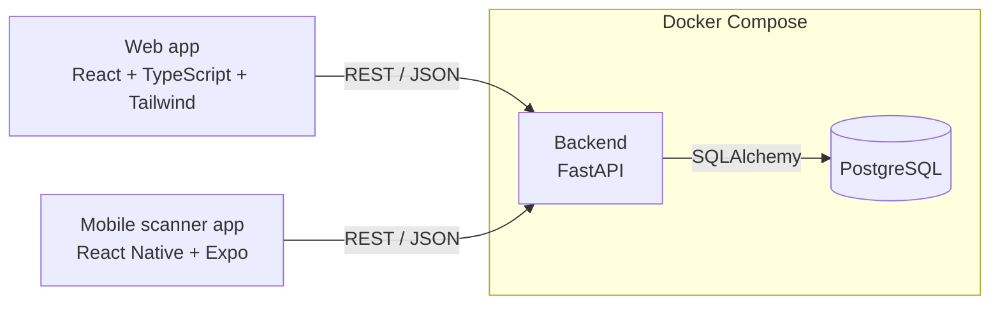
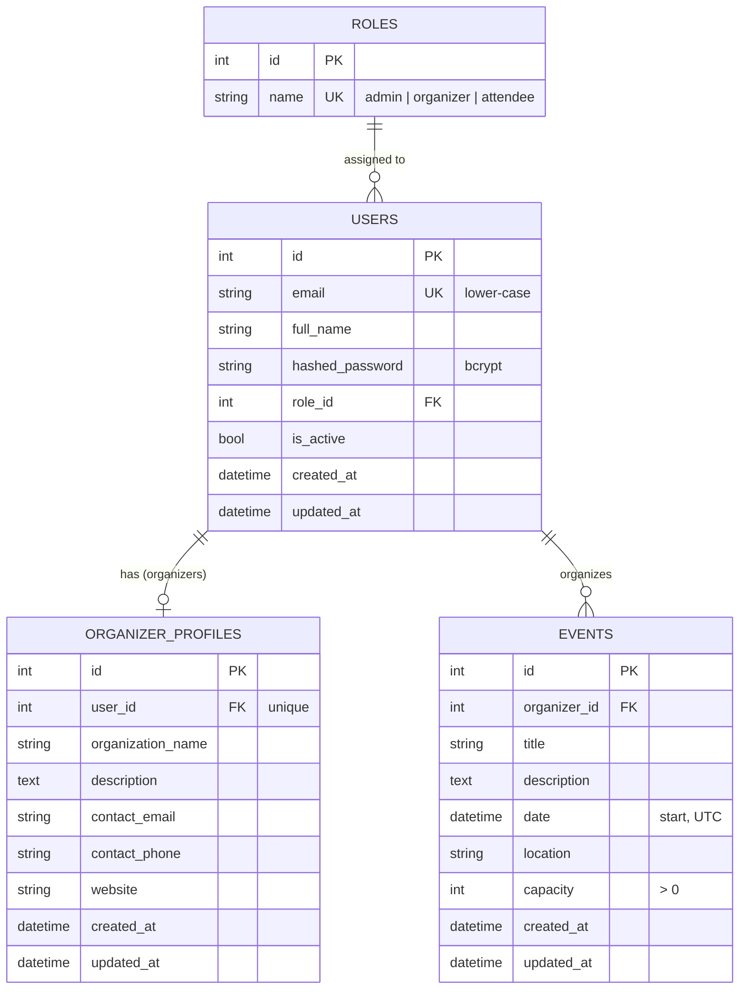

# Palantir – System Architecture

Client–server architecture. Two clients talk to one REST API; the API owns the database.



| Layer | Technology |
|---|---|
| Web frontend | React, TypeScript, Tailwind CSS |
| Mobile (event-staff ticket scanning) | React Native with Expo |
| Backend | FastAPI (Python), REST + JSON, interactive docs at `/docs` |
| Database | PostgreSQL, accessed through SQLAlchemy 2.0, schema managed with Alembic migrations |
| Auth | JWT access + refresh tokens, bcrypt password hashes |
| Tests | pytest (backend), React Testing Library (frontend) |
| Deployment | Docker / Docker Compose (`docker-compose.yml`) |

## Backend structure (`backend/app/`)

```
main.py              FastAPI app, CORS, router registration
core/config.py       settings from environment variables
db/                  engine + session (session.py), declarative base (base.py), role seeding (seed.py)
models/              SQLAlchemy models: role, user, organizer_profile, event
schemas/             Pydantic request/response models (validation lives here)
auth/                security.py (bcrypt + JWT), service.py (logic), router.py (/auth/*)
dependencies/        auth.py (current user), roles.py (RBAC), db.py (session)
routers/             organizer_profiles.py, events.py, health.py
```

Request flow: **router → dependencies (token → user → role check) → model/DB**. Routers contain no
password or token logic; that lives in `auth/`.

## Data model



## Authentication and roles

* `POST /auth/register` creates an `attendee` or `organizer`. Admins cannot self-register; they are
  created with `python -m scripts.create_admin`.
* `POST /auth/login` (JSON) and `POST /auth/token` (OAuth2 form, used by the `/docs` "Authorize" button)
  return `{access_token, refresh_token, token_type}`. Access tokens live 30 min, refresh tokens 7 days.
* `POST /auth/refresh` exchanges a refresh token for a new pair. Tokens carry a `type` claim, so a refresh
  token cannot be used as an access token (and vice versa).
* Every protected endpoint depends on `get_current_user` (401 if the token is missing/invalid/expired,
  403 if the account is disabled). `require_roles(...)` in `dependencies/roles.py` adds the role check (403).

| Endpoint | Who |
|---|---|
| `GET /health`, `POST /auth/register`, `POST /auth/login`, `POST /auth/token`, `POST /auth/refresh` | anyone |
| `GET /auth/me`, `GET /organizer-profiles/{id}` | any logged-in user |
| `POST /organizer-profiles`, `GET /organizer-profiles/me`, `PUT\|PATCH /organizer-profiles/me`, `POST /events` | organizer |
| `GET /events/{id}`, `PUT\|PATCH /events/{id}` | the event's organizer, or an admin |

## Design decisions

* **One role per user** (`users.role_id`). Simple to enforce and test; can become many-to-many later.
* **Stateless JWT.** No server-side revocation yet; "log out" means the client discards its tokens.
* **bcrypt used directly** (not via passlib) – fewer moving parts. Passwords are limited to 72 bytes (bcrypt's limit).
* **Sync SQLAlchemy.** FastAPI runs the sync endpoints in a thread pool; Alembic stays straightforward.
* **Timestamps are UTC.** Datetimes without a timezone are interpreted as UTC; responses are always UTC.
* **Tests use in-memory SQLite**, the app targets PostgreSQL. Models avoid PostgreSQL-only types so both work;
  `tests/test_migrations.py` checks that the Alembic migration applies and rolls back cleanly.

## Not built yet (planned for the next iterations)

Event listing/search and publishing, ticket creation and QR codes, mobile check-in endpoints, a shared
staging deployment.
