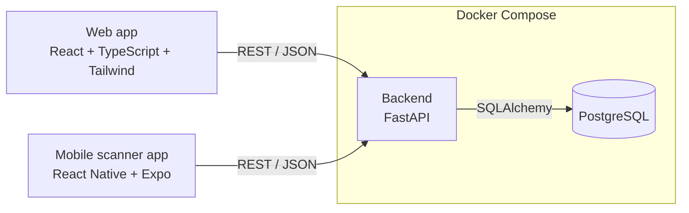
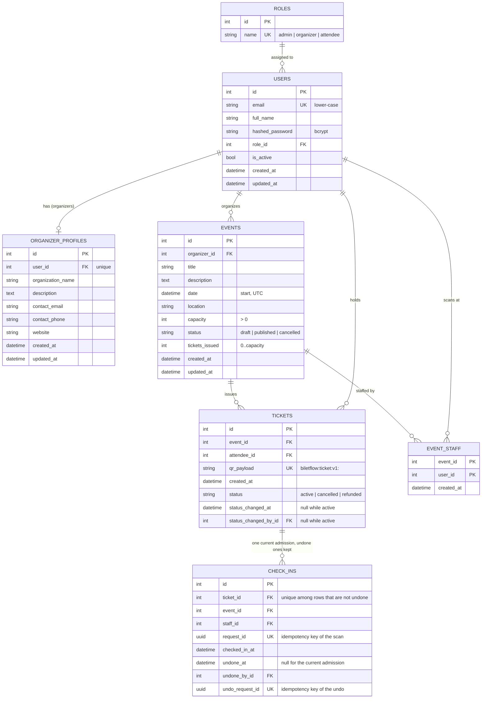

# Palantir – System Architecture

Client–server architecture. Two clients talk to one REST API; the API owns the database.



| Layer | Technology |
|---|---|
| Web frontend | React, TypeScript, Tailwind CSS |
| Mobile (event-staff ticket scanning) | React Native with Expo |
| Backend | FastAPI (Python), REST + JSON, interactive docs at `/docs` |
| Database | PostgreSQL, accessed through SQLAlchemy 2.0, schema managed with Alembic migrations |
| Auth | JWT access + refresh tokens, bcrypt password hashes |
| Tests | pytest (backend), React Testing Library (frontend) |
| Deployment | Docker / Docker Compose (`docker-compose.yml`) |

## Backend structure (`backend/app/`)

```
main.py              FastAPI app, CORS, router registration
core/config.py       settings from environment variables
db/                  engine + session (session.py), declarative base (base.py), role seeding (seed.py)
models/              SQLAlchemy models: role, user, organizer_profile, event, ticket, event_staff, check_in
schemas/             Pydantic request/response models (validation lives here)
auth/                security.py (bcrypt + JWT), service.py (logic), router.py (/auth/*)
dependencies/        auth.py (current user), roles.py (RBAC), events.py (event access), db.py (session)
errors.py            api_error(): {"detail": {"code", "message"}} for clients that branch on codes
routers/             organizer_profiles.py, events.py, tickets.py, staff.py, check_ins.py, health.py
```

Request flow: **router → dependencies (token → user → role check) → model/DB**. Routers contain no
password or token logic; that lives in `auth/`.

## Data model



`tickets` is also unique on (`event_id`, `attendee_id`): one free ticket per person per event.

## Authentication and roles

* `POST /auth/register` creates an `attendee` or `organizer`. Admins cannot self-register; they are
  created with `python -m scripts.create_admin`.
* `POST /auth/login` (JSON) and `POST /auth/token` (OAuth2 form, used by the `/docs` "Authorize" button)
  return `{access_token, refresh_token, token_type}`. Access tokens live 30 min, refresh tokens 7 days.
* `POST /auth/refresh` exchanges a refresh token for a new pair. Tokens carry a `type` claim, so a refresh
  token cannot be used as an access token (and vice versa).
* Every protected endpoint depends on `get_current_user` (401 if the token is missing/invalid/expired,
  403 if the account is disabled). `require_roles(...)` in `dependencies/roles.py` adds the role check (403).

| Endpoint | Who |
|---|---|
| `GET /health`, `POST /auth/register`, `POST /auth/login`, `POST /auth/token`, `POST /auth/refresh` | anyone |
| `GET /events`, `GET /events/{id}` (published or cancelled, not suspended) | anyone |
| `GET /events/{id}` (draft or suspended) | the event's organizer, or an admin |
| `GET /auth/me`, `GET /organizer-profiles/{id}` | any logged-in user |
| `POST /events/{id}/tickets`, `GET /tickets/me`, `GET /tickets/{id}`, `GET /tickets/{id}/pdf` (own) | any logged-in user |
| `GET /staff/events` | any logged-in user (lists what they may scan; may be `[]`) |
| `POST /organizer-profiles`, `GET /organizer-profiles/me`, `PUT\|PATCH /organizer-profiles/me` | organizer |
| `POST /events`, `GET /events/mine` | organizer |
| `PUT\|PATCH /events/{id}`, `POST /events/{id}/publish`, `POST /events/{id}/cancel` | the event's organizer, or an admin |
| `GET\|POST /events/{id}/staff`, `DELETE /events/{id}/staff/{user_id}` | the event's organizer, or an admin |
| `POST /events/{id}/check-in` | the event's assigned staff, its organizer, or an admin |
| `POST /events/{id}/check-ins/{check_in_id}/undo` | the event's organizer, or an admin |
| `POST /tickets/{id}/cancel` | the ticket's attendee, the event's organizer, or an admin |
| `POST /tickets/{id}/refund` | the event's organizer, or an admin |
| `GET /events/{id}/attendance`, `GET /events/{id}/attendees?q=` | the event's assigned staff, its organizer, or an admin |
| `GET /events/{id}/action-log` | the event's organizer, or an admin |
| `GET /admin/users`, `POST /admin/users/{id}/suspend\|reactivate` | admin |
| `GET /admin/events`, `POST /admin/events/{id}/suspend\|reactivate`, `GET /admin/action-log` | admin |

## Design decisions

* **One role per user** (`users.role_id`). Simple to enforce and test; can become many-to-many later.
* **Stateless JWT.** No server-side revocation yet; "log out" means the client discards its tokens.
* **bcrypt used directly** (not via passlib) – fewer moving parts. Passwords are limited to 72 bytes (bcrypt's limit).
* **Sync SQLAlchemy.** FastAPI runs the sync endpoints in a thread pool; Alembic stays straightforward.
* **Timestamps are UTC.** Datetimes without a timezone are interpreted as UTC; responses are always UTC.
* **Tests use in-memory SQLite**, the app targets PostgreSQL. Models avoid PostgreSQL-only types so both work;
  `tests/test_migrations.py` checks that the Alembic migration applies and rolls back cleanly.

## Tickets and check-in

* Events start as `draft`, become `published` (ticketing and check-in open) and can be `cancelled` (final).
  Publishing is a conditional update, so it can never overwrite a concurrent cancel.
* Claiming a ticket takes an event seat with `UPDATE events SET tickets_issued = tickets_issued + 1
  WHERE ... AND tickets_issued < capacity`; the check constraint backs it up. P1 reserves the type's
  seat in the same transaction.
* Check-in follows `mobile/API.md`. The `check_ins` row is the receipt: resending the same `request_id`
  (same staff, event and QR) returns it, any other reuse is `409 REQUEST_ID_CONFLICT`. A partial unique index on
  `ticket_id` over the rows that are not undone makes a second current admission impossible even when two phones
  scan at once. Access is checked on every request, retries included, so revoked staff get `403`.
* A ticket is `active`, `cancelled` or `refunded` (migration `0003`). The last two are final and never admit:
  check-in answers `409 TICKET_CANCELLED` or `409 TICKET_REFUNDED`. They describe one ticket; `EVENT_CANCELLED`
  describes the whole event and is reported first. Closing a ticket gives its seat back
  (`tickets_issued - 1`), so `tickets_issued` counts active tickets. The ticket keeps its id and `qr_payload`, and
  the attendee's claim keeps returning that closed ticket. A ticket with a current admission cannot be closed
  (`409 TICKET_CHECKED_IN`) until the check-in is undone, so `checked_in` never exceeds `tickets_issued`.
  Tickets are free: `refunded` records the admission state only and no payment is processed.
* `GET /tickets/{id}/pdf` returns the printable ticket: one A4 page drawn with `fpdf2`, the QR built by `qrcode`
  from exactly `ticket.qr_payload` with error correction M and a four-module quiet zone, as on the website. The code
  is black vector rectangles that overlap slightly, because some renderers otherwise leave a white hairline between
  rows and the code stops scanning. Text uses the bundled DejaVu Sans (`app/assets/fonts`, licence beside it), which
  has the Russian and Kazakh letters. The event time is printed in UTC+5 with the offset shown. A closed ticket or a
  ticket of a cancelled event is not printed (`409`). The response is `private, no-store`.
* Undo (`POST /events/{id}/check-ins/{check_in_id}/undo`, organizer or admin) keeps the `check_ins` row and sets
  `undone_at`, `undone_by_id` and `undo_request_id`. The undo has its own `request_id`, so a retry returns the same
  `UNDONE` receipt. The undone check-in's own `request_id` then answers `409 CHECK_IN_UNDONE`: it cannot admit
  again and is never replayed as a success. A new scan with a new `request_id` admits the ticket again as a new
  row. Check-in, undo, cancel and refund lock the event row first and then the ticket row, so they serialise per
  ticket without deadlocks.
* Check-in holds the event row `FOR SHARE` until it commits, so a cancel or publish waits for scans in flight and a scan
  never mixes an old event status with newer staff access. Parallel scans do not block each other.
* New endpoints report errors as `{"detail": {"code": "...", "message": "..."}}`. Codes: `EVENT_NOT_FOUND`,
  `EVENT_NOT_PUBLISHED`, `EVENT_CANCELLED`, `SOLD_OUT`, `CAPACITY_BELOW_ISSUED`, `TICKET_NOT_FOUND`,
  `USER_NOT_FOUND`, `STAFF_CHANGED`, `FORBIDDEN`, `INVALID_TICKET`, `ALREADY_CHECKED_IN`, `REQUEST_ID_CONFLICT`,
  `QUERY_TOO_SHORT`, `TICKET_CANCELLED`, `TICKET_REFUNDED`, `TICKET_CHECKED_IN`, `CHECK_IN_UNDONE`,
  `CHECK_IN_NOT_FOUND`, `CHECK_IN_ALREADY_UNDONE`, `UNDO_NOT_ALLOWED`, `EVENT_SUSPENDED`, `CANNOT_SUSPEND_SELF`.
* `GET /events/{id}/attendance` returns `capacity` and `tickets_issued` from the event row and `checked_in` as a
  `COUNT` of its `check_ins` that are not undone, all read in one statement. `GET /events/{id}/attendees?q=` searches the event's ticket
  holders by name or e-mail (case-insensitive substring, `q` at least 3 characters after trimming, `%`/`_` literal,
  at most 20 results ordered by name). Each result carries the ticket `status`, the
  current `check_in_id` (or `null`) and the exact `qr_payload`, so manual admission goes through the same check-in
  endpoint; there is no second write path. E-mails are masked to at most two leading characters,
  always hiding at least one, plus a fixed `***` and the domain (`ab@x.kz` → `a***@x.kz`). Access is checked before
  `q` is validated.
* Values PostgreSQL refuses to store (NUL characters, ids beyond its integer range) return
  `422 INVALID_INPUT` on every endpoint instead of a 500.

### P1 ticket type inventory and action log

`ticket_types` belongs to an event. It holds the current name, description, integer price
in tiyn, allocation, active ticket count, sales window, order limit and visibility. Every
ticket refers to one type and retains its existing event and attendee identity. The
`(event_id, attendee_id)` uniqueness rule still applies across all types.

The original conditional event update takes the event row lock and reserves an event seat.
A second conditional update reserves the chosen free type's seat in the same transaction.
A rollback returns both reservations. Cancellation and refund release both counters.
Management requests also lock the event row before reading or changing allocations, so
two concurrent requests cannot allocate more seats than the event has.

`action_logs` stores the event, actor, UTC time, action, entity and short description.
The caller adds the record in the transaction that creates or changes a type. The owner
and administrators can read the event's history. The API exposes no write operation on
the history itself.

### Admin suspension and the full event timeline

Migration `0005` adds `events.suspended_at` and makes `action_logs.event_id` nullable.

**Suspending an event** (`POST /admin/events/{id}/suspend`, admin only, with a `reason`) hides it from everyone
except its organizer and admins, exactly like a draft: it leaves the public list, and its details, ticket types and
ticket claims answer `404 EVENT_NOT_FOUND`. The organizer and admins see it with `suspended: true` and cannot
issue tickets either (`409 EVENT_SUSPENDED`). The suspension takes the event row lock, so it waits for claims in
flight, and the claim's seat `UPDATE` requires `suspended_at IS NULL`, so a claim that loses the race is refused
with `409 EVENT_SUSPENDED` and takes no seat. Suspension is independent of `status`: reactivating restores the
event as it was. Tickets issued earlier stay readable and still admit; check-in is unchanged.

**Suspending a user** (`POST /admin/users/{id}/suspend`) sets the existing `users.is_active` to false. Sign-in and
every request with an existing token are refused at once. An admin cannot suspend their own account
(`409 CANNOT_SUSPEND_SELF`). Both suspensions are idempotent and reversible with `/reactivate`.

**The timeline.** Besides ticket-type changes, the action log records, in the same transaction as the change:
`event.created`, `event.updated` (capacity and date with old and new values, texts as "changed"),
`event.published`, `event.cancelled`, `event.suspended`, `event.reactivated`, `staff.assigned`, `staff.removed`,
`ticket.cancelled`, `ticket.refunded`, `check_in.created`, `check_in.undone`, and the platform actions
`user.suspended` and `user.reactivated` (no event). Repeats and no-ops write nothing, and a refused or rolled-back
request leaves no entry. Claiming a ticket is not a management action and is not recorded.

`GET /events/{id}/action-log` (organizer or admin) returns the event's entries newest first, each with
`actor_id` and `actor_name`. Optional filters: `date_from`, `date_to`, `action` (an exact type such as
`event.published`, or the group before its dot such as `check_in`; `ticket` does not select `ticket_type.*`, and
`_` and `%` are literal), `limit` (default 200, at most 500) and `offset`.
`GET /admin/action-log` (admin) reads the whole platform's history with the same filters plus `event_id`.

#### Suspension contract for later phases

Checkout, promo codes, analytics and any other new code follow these rules, so that a suspended event behaves the
same everywhere:

- **Is it suspended?** `events.suspended_at IS NOT NULL` (`suspended: true` in event responses). `status` is not
  touched and there is no suspended status value, so always test `suspended_at`, never `status`.
- **Public lists and reads** filter `suspended_at IS NULL` in the query, or call `is_visible(event, user)` from
  `app/dependencies/events.py` for one event (a suspended event is `404 EVENT_NOT_FOUND` for everyone except its
  organizer and admins).
- **Every path that sells or issues** (free claims today; orders, promo codes and the like later) calls
  `ensure_not_suspended(event)` from `app/dependencies/events.py` on the event row read under `lock_event`, and
  keeps `suspended_at IS NULL` in its conditional `UPDATE`. The check gives `409 EVENT_SUSPENDED`; the `UPDATE`
  condition is what stops a request that raced the suspension. The free claim takes its row lock with the seat
  `UPDATE` itself and calls the same check before it and after a lost race.
- **Check-in is unaffected**: the check-in routes never read `suspended_at`, so tickets issued before the
  suspension still admit.
- **Admin routes**: `POST /admin/events/{id}/suspend` (with a `reason`) and `POST /admin/events/{id}/reactivate`;
  `POST /admin/users/{id}/suspend` and `POST /admin/users/{id}/reactivate`. Both are idempotent.
- **Platform actions** that belong to no event are written with `record_action(db, event_id=None, ...)` into
  `action_logs`, in the transaction of the change. There is no separate admin table.

## Not built yet

Paid tickets, offline check-in, pagination and search for event lists, a shared staging deployment.
